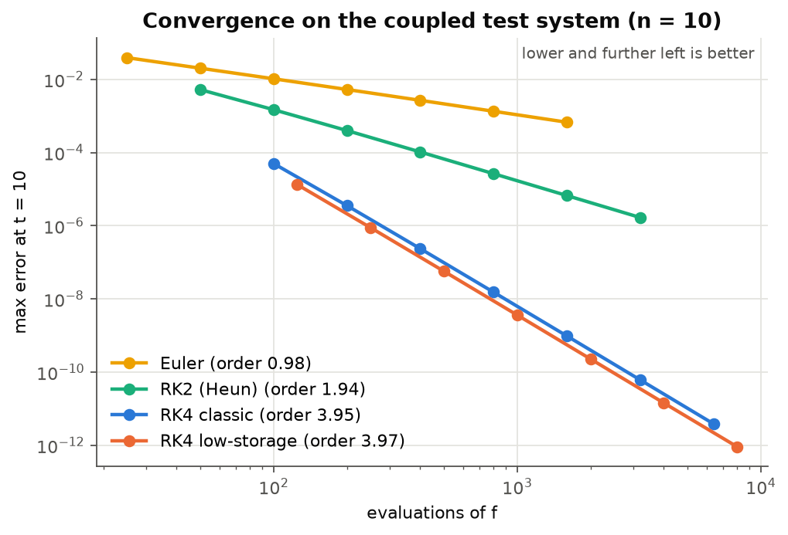
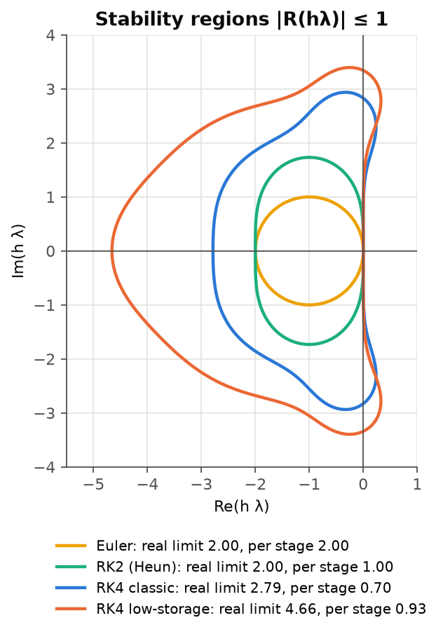
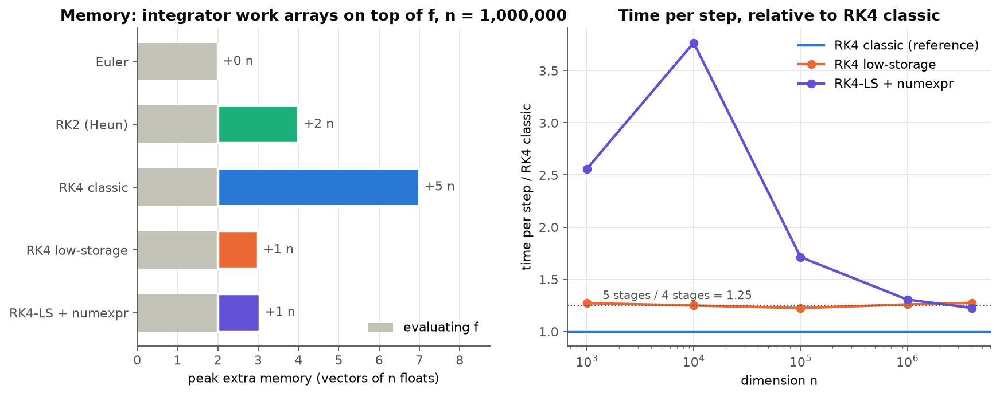
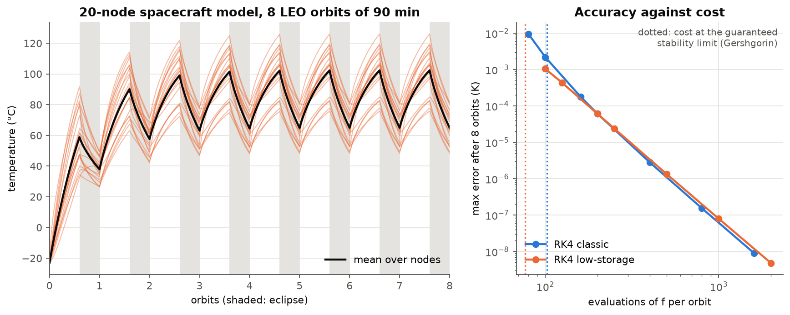

# Low-storage Runge-Kutta for spacecraft thermal simulation

[](https://github.com/Nic0lasmurat0re/rk4-low-storage/actions/workflows/tests.yml)

Satellite thermal solvers integrate the temperatures of thousands of coupled nodes
with the classical fourth-order Runge-Kutta scheme (RK4), which keeps four stage
vectors in memory. This project compares it with the **2N-storage RK4 of Carpenter &
Kennedy (1994)**, which reaches the same order with a single work vector, on accuracy,
stability, memory and run time, then applies both to a nodal thermal model of a
spacecraft in low Earth orbit.

*Semester project, 4th year of applied mathematics (MAM4), Polytech Nice Sophia,
2025–2026. Nicolas Muratore and Mohamad Rida, supervised by Vincent Vadez. The
subject is built around the Fortran thermal solver of DOREA, a space simulation
company in Sophia Antipolis.*

## Key results

| | RK4 classic | RK4 low-storage |
|---|---|---|
| Order of convergence (measured) | 3.95 | 3.97 |
| Work arrays kept by the integrator | **5 n** | **1 n** |
| Peak memory including the evaluation of f | 7 n | 3 n |
| Evaluations of f per step | 4 | 5 |
| Time per step (n = 10³ to 4·10⁶) | 1 | 1.22 to 1.27 |
| Real-axis stability limit of h λ | 2.79 | **4.66** |
| Stability limit per evaluation of f | 0.70 | **0.93** |

- **Memory.** The low-storage scheme cuts the integrator's own memory by a factor of
  five: one vector instead of five. For a solver whose memory is dominated by the
  state, this is the difference between 7 n and 3 n floats.
- **Stability, the less obvious gain.** Its stability interval on the negative real
  axis is 67 % longer. Thermal conduction is a diffusion problem whose step is limited
  by stability, not accuracy, so the low-storage scheme can take steps 1.67 times
  larger. Despite its fifth stage, it then needs **about 25 % fewer evaluations of f**
  than classical RK4 for a stable run.
- **Time per step** grows by the expected 5/4 ratio. Multi-threading the vector
  updates with numexpr only overtakes plain NumPy beyond n ≈ 10⁶, and by a few
  percent: the right-hand side dominates the cost, and the time loop is sequential
  (Amdahl's law).

## Figures

**Convergence.** Both RK4 variants are fourth order. At equal cost, the low-storage
scheme is slightly more accurate on this problem.



**Stability regions.** The low-storage scheme reaches h λ = −4.66 on the real axis,
against −2.79 for classical RK4.



**Memory and time.** Memory peaks are measured with `tracemalloc` at n = 10⁶. Grey is
the cost of evaluating f, shared by every method.



**Spacecraft thermal model.** Twenty nodes with conduction and radiation between
neighbours, radiation to deep space, solar, albedo and Earth infrared fluxes, and
internal dissipation. After three to four orbits the temperatures settle into a periodic
regime, heating in sunlight and cooling in eclipse. On the right, both schemes reach
the same accuracy for the same cost, but the low-storage scheme stays stable down to a
lower cost (dotted lines).



## The method

For y' = f(t, y), each step of the 2N-storage scheme runs five stages with two
registers, the state y and one vector d:

```
d ← A_s d + h f(t_n + c_s h, y)
y ← y + B_s d                          s = 1, …, 5
```

The coefficients A_s, B_s and c_s are those of Carpenter & Kennedy (solution 3). In
[`schemes.py`](src/lsrk/schemes.py) every scheme updates y in place and owns its work
arrays, so the memory comparison measures the schemes, not Python temporaries.

Each node i of the thermal model obeys

```
MC_i dT_i/dt = α_i S_i (φ_sun + φ_albedo) s(t) + ε_i S_i φ_IR + Q_i
             + Σ_j GL_ij (T_j − T_i) + σ Σ_j GR_ij (T_j⁴ − T_i⁴) − ε_i S_i σ T_i⁴
```

where s(t) switches between 1 in sunlight and 0 in eclipse. The model is integrated
one phase at a time: a stage evaluated exactly on the jump, which happens at t + h in
classical RK4, would see the wrong phase and drop the scheme to first order.

## Repository layout

```
src/lsrk/
  schemes.py      Euler, RK2, RK4, RK4 low-storage (NumPy and numexpr), solve()
  stability.py    stability polynomials and real-axis limits
  thermal.py      nodal thermal model, stability-limited step, phase-by-phase simulate()
  problems.py     coupled test system used in the benchmarks
scripts/          one script per figure
tests/            convergence orders, stage times, stability limits, memory, thermal model
docs/             original report and slides (2025–2026)
```

## Running it

```bash
git clone https://github.com/Nic0lasmurat0re/rk4-low-storage.git
cd rk4-low-storage
python -m venv .venv && source .venv/bin/activate
pip install -e ".[test]"

pytest                            # 18 tests, under a second
python scripts/convergence.py     # each script prints its numbers and writes figures/*.png
python scripts/stability.py
python scripts/thermal_case.py
python scripts/benchmark.py       # about two minutes
```

Timings above were measured on an Apple M1 Pro (8 cores) with Python 3.14 and NumPy 2.5.

## Changes from the original report

This repository is a rewrite of the project code (October 2026). The report and
slides in [`docs/`](docs/) are the versions submitted for the project. The rewrite corrects
several points, which change some of the report's conclusions:

1. **Stage times.** In the report's thermal case, all five stages evaluated f at t_n
   instead of t_n + c_s h. This breaks fourth order as soon as f depends on time.
2. **Radiation to deep space** was missing from the thermal model, so the nodes could
   only heat up. It is now included, and the nodes cool in eclipse.
3. **Sunlit/eclipse discontinuity.** The model is integrated one phase at a time.
   Otherwise classical RK4 converges at first order (shown in the tests).
4. **Stability limit.** The report gave 2.80 for the low-storage scheme. The value
   computed from its stability polynomial is 4.66, which makes stability a second
   argument in favour of the scheme, alongside memory.
5. **Memory.** The report measured a 28 % reduction, with the full trajectory stored
   and temporaries counted. With in-place updates, the integrator's own overhead
   drops from 5 n to 1 n.
6. **Order of convergence** is now measured by step refinement, against a reference
   computed with tolerances of 10⁻¹³.
7. **Stable step bound.** The Gershgorin bound on a conduction Laplacian carries a
   factor of 2 that the report's CFL estimate omitted.

## Reference

M. H. Carpenter and C. A. Kennedy, *Fourth-order 2N-storage Runge-Kutta schemes*,
NASA Technical Memorandum 109112, 1994.

## License

[MIT](LICENSE)
